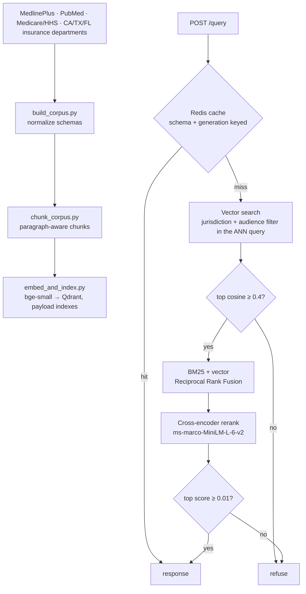
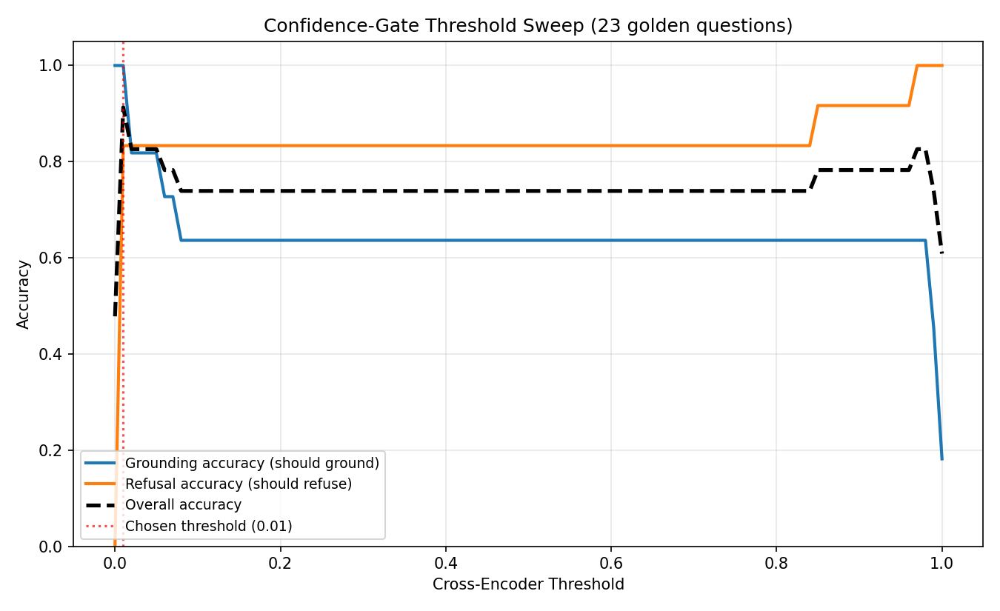

# Patient Education & Policy Retrieval Gateway

A retrieval backend that answers patient and clinician questions about
chronic conditions, Medicare, HIPAA and state health-insurance rules. It
returns cited source excerpts scoped to the asker's jurisdiction and
audience, or refuses when the corpus does not support an answer. There is
no LLM generation step: every answer is retrieved text with its source.


## Problem

Three failure modes matter in a health-policy retrieval system:

1. **Wrong jurisdiction**: California rules returned to a Texas resident.
2. **Stale cache**: an answer cached before a policy update served after it.
3. **Confident near-misses**: a question the corpus does not cover answered
   with something topically similar (*diabetes insipidus* answered with
   *diabetes mellitus* content).

The design addresses each one separately, and the evaluation measures each
one separately.

## Architecture



## Design decisions

**Jurisdiction filtering inside the vector query.** The jurisdiction and
audience filter is passed to Qdrant's ANN search, so out-of-scope chunks
never enter the candidate set. BM25 scores the whole corpus and then
filters, so filtering never truncates results. Tested for CA, TX and FL,
including a question that names California asked from Texas.

**Hybrid retrieval.** Embeddings blur exact terms such as drug names and
plan codes. BM25 and vector rankings are fused with Reciprocal Rank Fusion
(k = 60).

**Cache invalidation by generation counter.** Each cache key embeds a
generation number for every jurisdiction it depends on (federal plus the
state). Re-indexing a jurisdiction is a single `INCR`; after it, requests
compute new keys and old entries are never read again. A reverse index of
"which cached answers used which document" would race: a request that
started before an update could write its stale answer after the
invalidation ran.

**Schema version in the cache key.** A code change (for example adding the
reranker) changes answers without changing data. `SCHEMA_VERSION` in the
key orphans entries written by older code.

**Two-stage confidence gate.** A cheap cosine floor rejects clearly
unrelated questions before reranking. The cross-encoder threshold (0.01)
was chosen on the dev set to avoid refusing vaguely phrased genuine
questions, whose scores go as low as 0.012.

**Failure behavior.** Redis is optional: if it is down, queries are
computed without caching. Qdrant is required: if it is down the API
returns 503.

## Evaluation

113 questions in three sets (`eval/`, protocol in `eval/README.md`). The
threshold was tuned on **dev** only. CI rebuilds the index and runs all
three sets on every pull request.

| Set | n | Accuracy | hit@5 | Refusal accuracy | Jurisdiction violations |
|---|---:|---:|---:|---:|---:|
| dev (tuning set) | 23 | 91.3% | 11/11 | 10/12 | 0 |
| held-out | 60 | 100% | 54/54 | 6/6 | 0 |
| adversarial | 30 | 70.0% | — | 21/30 | 0 |

Details: [`eval/results/2026-10-23.md`](eval/results/2026-10-23.md).

- **Jurisdiction and audience isolation held on all 113 questions.**
- **Held-out retrieval is perfect but easy**: the corpus has 37 documents,
  mostly one per topic.
- **The weak point is near-miss refusal.** 9 of 30 adversarial questions
  were answered instead of refused: pulmonary hypertension, hypotension,
  kidney stones, chronic fatigue syndrome, sinus infection, appendicitis
  and hepatitis C guidelines, an ibuprofen interaction, and asthma in
  horses. On the dev set, *diabetes insipidus* and *diabetes mellitus type
  3c* fail the same way (cross-encoder scores 0.84–0.96). The
  general-domain cross-encoder scores topical overlap highly, and no single
  threshold separates these from genuine low-scoring answers. A
  medical-domain reranker or an entity-disambiguation step is the likely
  fix.



## Quick start (Docker Compose)

```bash
docker compose up --build
curl -X POST localhost:8000/query -H 'content-type: application/json' \
     -d '{"question": "does Medicare cover insulin", "jurisdiction": "CA"}'
```

Starts Redis, a Qdrant server, a one-shot indexer that builds the index
from the committed `data/processed/`, and the API. CI runs the same stack
and checks a grounded answer, a refusal and a cache hit.

## Local development

```bash
pip install -r requirements.txt          # pulls torch for the cross-encoder
docker run -d -p 6379:6379 redis          # optional; or CACHE_ENABLED=false

python build_corpus.py
python chunk_corpus.py
python embed_and_index.py
python -m uvicorn api.main:app --port 8000

python run_eval.py                         # all three eval sets
```

Settings (Qdrant URL or path, Redis URL, thresholds) are environment
variables listed in `settings.py`.

### Refreshing source data

```bash
python fetch_medlineplus.py
python fetch_pubmed.py                    # NCBI_API_KEY optional, raises rate limit
python fetch_cms.py
python fetch_state_insurance.py           # pages listed in config/state_pages.toml
python load_manual_pages.py               # for pages that block scripted fetches
# then rebuild the index and invalidate the affected jurisdictions:
python invalidate_jurisdiction.py federal
```

## Tests

```bash
pip install pytest httpx
pytest tests -v                           # 39 tests, no model download
RUN_MODEL_TESTS=1 pytest tests/test_models.py -v
```

Unit and API tests use the real Qdrant (in-memory), BM25, RRF, cache
(fakeredis) and FastAPI code with stand-in embedding and reranking models.
Model tests load the real models; the insipidus/mellitus confusion is a
strict expected failure that will flag if a model change fixes it.

## API

`POST /query`

```json
{"question": "does Medicare cover insulin", "audience": "patient", "jurisdiction": "CA", "top_k": 5}
```

Returns `answer_grounded`, `sources` (text, title, url, jurisdiction,
audience, effective_date, score), `cache_hit`, and the raw
`top_vector_score` and `top_cross_encoder_score`. Refusals carry a
`message` and no sources.

## Project structure

```
api/main.py                  FastAPI endpoint, gating, caching
settings.py                  environment-based configuration
hybrid_search.py             BM25 index and Reciprocal Rank Fusion
reranker.py                  cross-encoder reranking
query_cache.py               Redis cache with generation and schema keys
invalidate_jurisdiction.py   bump a jurisdiction's cache generation
fetch_*.py, load_manual_pages.py, common.py   ingestion
build_corpus.py, chunk_corpus.py, embed_and_index.py   indexing
config/state_pages.toml      state insurance sources
eval/                        dev, held-out, adversarial sets and results
run_eval.py                  evaluation harness
tests/                       unit, API and model tests
```

## Known limitations

- Near-miss questions are often answered instead of refused (see
  Evaluation).
- The corpus is small: 8 MedlinePlus topics, 24 PubMed abstracts, 3
  Medicare/HHS pages, and one consumer guide each for CA, TX and FL.
- Two PubMed abstracts in the clinician corpus are veterinary (feline
  kidney disease, feline diabetes), one PubMed record has an empty
  abstract, and the MedlinePlus "heart disease" page is the Heart Valve
  Diseases page.
- No generation step: answers are source excerpts, not synthesized prose.

## License

MIT — see [LICENSE](LICENSE).
